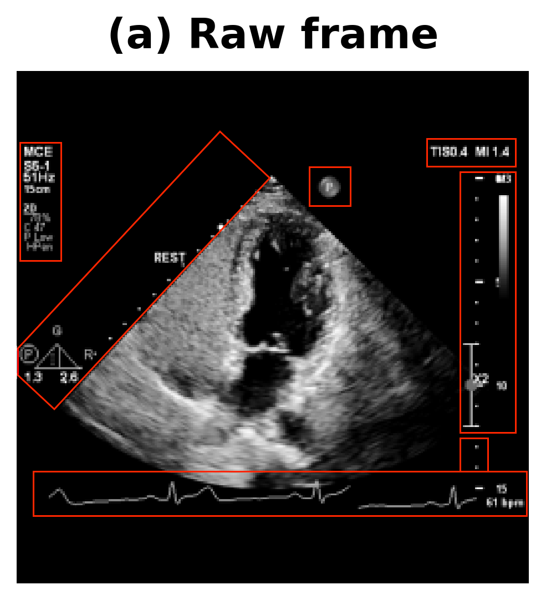
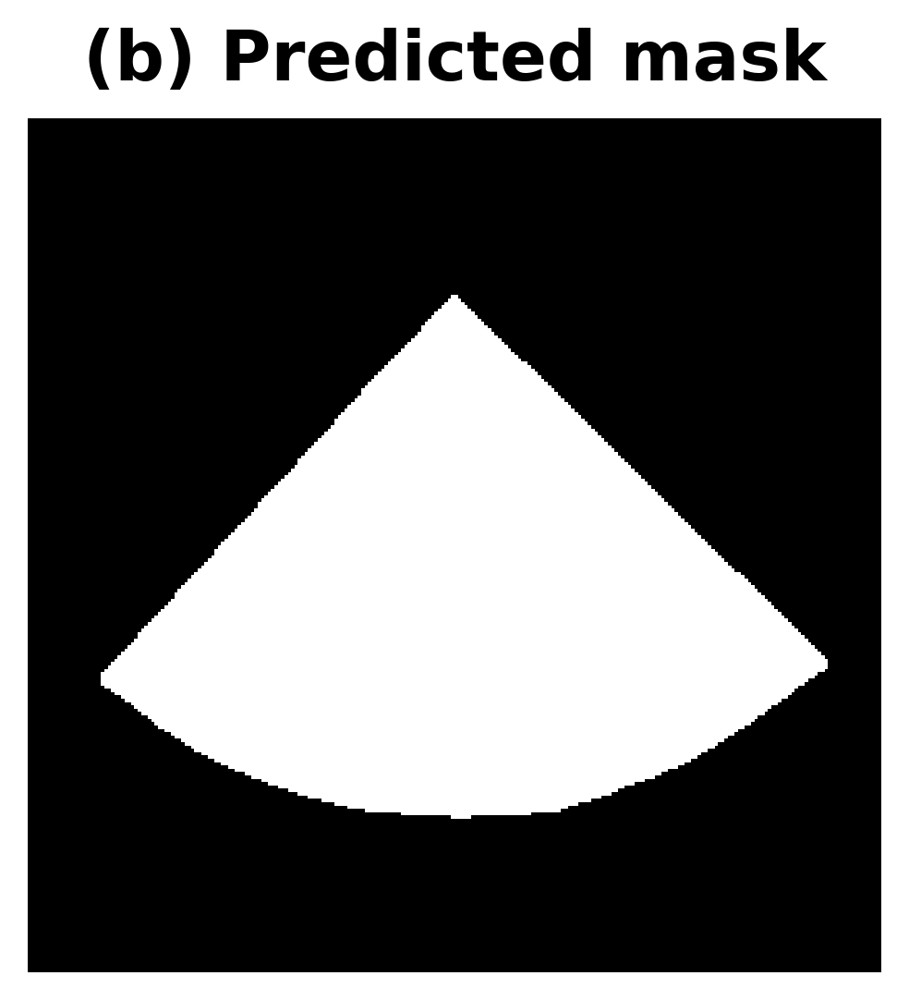
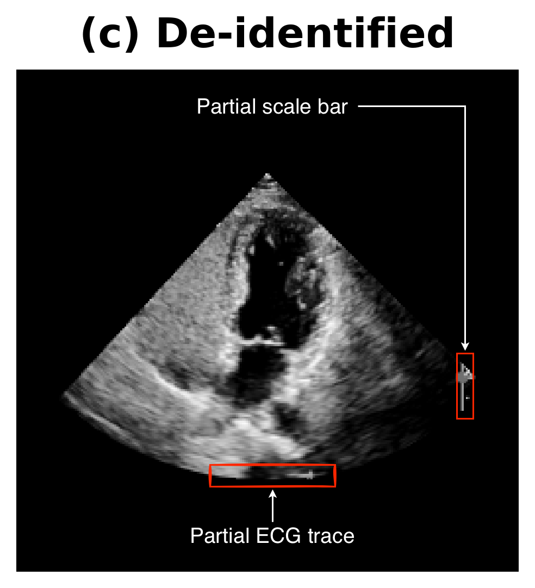
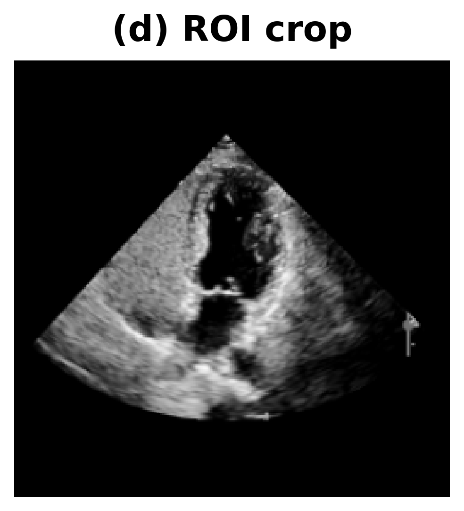

# EchoROI

**A U-Net-based tool for echocardiographic ROI segmentation and scan-sector masking.**

[](https://pypi.org/project/echoroi/)
[](LICENSE)
[](https://www.python.org/)
[](https://www.tensorflow.org/)
[](https://onnxruntime.ai/)
[](https://github.com/Kamlin-MD/UNET-Echocardiography-ROI-segmentation/actions/workflows/ci.yml)

---

## Example Output

<p align="center">
  
  
  
  
</p>

**(a)** Raw frame with burned-in overlays — **(b)** predicted scan-sector mask — **(c)** sector-masked output — **(d)** ROI crop.

---

## Overview

EchoROI segments the fan-shaped ultrasound scan sector in echocardiography frames and masks pixels outside the predicted sector, removing surrounding scanner chrome, ECG traces, measurement overlays, text, and vendor graphics. The result is a clean, standardised image suitable for:

- **De-identification aid** — removing burned-in content outside the predicted scan sector. Identifiers and overlays inside the sector can remain.
- **Preprocessing for machine learning** — delivering only clinically relevant pixels to downstream models.
- **Standardised cropping** — producing consistent inputs from heterogeneous multi-site, multi-vendor datasets.

The authors' reference model (U-Net, ~31 M parameters) achieved a Dice coefficient
of **0.9884** in the saved validation evaluation. The documented annotation
collection contains 1,355 frames across eight datasets, but the saved run records
contain 1,206 loaded pairs (964 training / 242 validation). The missing per-file
provenance prevents attribution of that difference; see the
[run-record reconciliation](training_results/README.md).

Pretrained weights are not distributed with this release because the contributing datasets have differing access and reuse conditions. Researchers must obtain source datasets independently from their providers. Requests for scan-sector annotations should be directed to the EchoROI authors; availability is assessed for each dataset under the applicable agreements and institutional permissions.

See the [annotation-access policy](docs/ANNOTATION_ACCESS.md) and
[retraining instructions](docs/RETRAINING.md). The MIT licence applies to the
released software, not independently obtained datasets or annotation packages.

---

## Key Features

- **Scan-sector segmentation** — binary mask prediction for the ultrasound field of view.
- **Sector masking** — zero out all non-ROI pixels in a single step with `--deidentify`.
- **ROI cropping** — extract and resize the scan sector for downstream pipelines.
- **Keras + ONNX support** — use a local checkpoint; ONNX enables inference without TensorFlow.
- **CLI and Python API** — scriptable workflows for prediction, training, evaluation, and benchmarking.
- **DICOM preprocessing pipeline** — batch-process DICOM datasets via the included notebook.

---

## Installation

### From PyPI

```bash
pip install echoroi
```

> **Note:** Neither the PyPI package nor the repository release distributes
> pretrained checkpoints or source datasets. Cloning does not supply a model.
> Train locally or otherwise obtain a checkpoint lawfully; see
> [checkpoint availability](models/README.md).

### From source (for development)

```bash
git clone https://github.com/Kamlin-MD/UNET-Echocardiography-ROI-segmentation.git
cd UNET-Echocardiography-ROI-segmentation
pip install -e ".[dev]"
```

---

## Quickstart

Inference requires a locally trained or otherwise lawfully obtained checkpoint.
Replace `path/to/model.keras` with its actual path. The ONNX example requires
your own corresponding export, `path/to/model.onnx`.

### CLI — predict and mask

```bash
# Predict masks for a directory of frames
echoroi predict \
  --model-path path/to/model.keras \
  --input path/to/frames/ \
  --output results/

# Predict + mask in one step
echoroi predict \
  --model-path path/to/model.keras \
  --input path/to/frames/ \
  --output results/ \
  --deidentify
```

### Python API

```python
from echoroi import UNetPredictor

predictor = UNetPredictor("path/to/model.keras")
mask = predictor.predict_single_image("path/to/frame.png")  # (256, 256, 1) array
```

### ONNX inference (no TensorFlow)

```python
import onnxruntime as ort
import numpy as np

sess = ort.InferenceSession("path/to/model.onnx")
# image: (1, 256, 256, 1) float32, normalised to [0, 1]
mask = sess.run(None, {"input": image})[0]
```

---

## Example Workflow

```
Input frames (PNG / DICOM)
  → Resize to 256×256 (aspect-ratio preserving, zero-padded)
  → U-Net mask prediction (scan sector vs. background)
  → Apply mask: zero out non-ROI pixels (sector masking)
  → Crop to scan-sector bounding box → resize to target dimensions
  → Save cleaned frames / compressed NPZ
```

The [DICOM preprocessing notebook](notebooks/04_dataset_preprocessing.ipynb) implements this end-to-end with adaptive stride, representative-frame selection (Shannon entropy), and batch processing.

---

## Repository Structure

```
EchoROI/
├── echoroi/              # Python package
│   ├── model.py          #   U-Net architecture & loss functions
│   ├── preprocessing.py  #   Image preprocessing utilities
│   ├── inference.py      #   Prediction helpers
│   ├── training.py       #   Training pipeline
│   └── cli.py            #   Command-line interface
├── models/
│   ├── README.md             # Checkpoint policy; no weights distributed
│   ├── echoroi_unified.keras # Optional local checkpoint (untracked)
│   └── echoroi_unified.onnx  # Optional local export (untracked)
├── notebooks/
│   ├── 01_training_and_evaluation.ipynb
│   ├── 02_onnx_conversion.ipynb
│   ├── 03_inference_demo.ipynb
│   └── 04_dataset_preprocessing.ipynb
├── data/                 # Local images & masks (untracked; obtain independently)
├── annotations/          # Policy & synthetic manifest only; packages untracked
├── docs/                 # Access policy and qualified retraining pathway
├── paper/                # Unrefereed technical manuscript and bibliography
├── tests/                # Unit tests, including synthetic manifest checks
├── scripts/              # Conversion & utility scripts
├── MODEL_CARD.md         # Model card with intended use & limitations
└── CITATION.cff          # Citation metadata
```

---

## Notebooks

| # | Notebook | Description |
|---|----------|-------------|
| 01 | [Training Records & Evaluation](notebooks/01_training_and_evaluation.ipynb) | Saved-run inspection and evaluation with a local checkpoint |
| 02 | [ONNX Conversion](notebooks/02_onnx_conversion.ipynb) | Export, validation, Keras-vs-ONNX comparison |
| 03 | [Inference Demo](notebooks/03_inference_demo.ipynb) | Inference, visualisation, ROI extraction |
| 04 | [Dataset Preprocessing](notebooks/04_dataset_preprocessing.ipynb) | DICOM → NPZ pipeline using ONNX model |

---

## Testing

```bash
pytest tests/ -v
```

### Note for macOS (Apple Silicon) users

The `tensorflow-metal` GPU plugin can deadlock inside Jupyter kernels on
some Apple Silicon configurations. The inference notebook
(`03_inference_demo.ipynb`) disables GPU devices automatically so that all
operations run on the CPU. This has no practical impact — inference on
256 × 256 images takes less than 1 second per frame on CPU.

---

## Citation

If you use EchoROI in your work, please cite the software repository and the version you used:

```bibtex
@software{ekambaram2026echoroi,
  author    = {Ekambaram, Kamlin and Arnab, Anurag and Herbst, Philip and
               Theart, Rensu},
  title     = {{EchoROI}: Scan-sector Segmentation and De-identification
               for Echocardiography},
  version   = {0.1.0},
  url       = {https://github.com/Kamlin-MD/UNET-Echocardiography-ROI-segmentation},
  year      = {2026}
}
```

See [`CITATION.cff`](CITATION.cff) for machine-readable citation metadata.

### Zenodo software archive

For an archived release, cite the **version-specific Zenodo DOI** for the
software version used. The concept DOI identifies the software across all
versions. No Zenodo DOI is asserted here until a deposit has been published.

Release maintainers should follow the [Zenodo release checklist](CONTRIBUTING.md#zenodo-release-checklist),
including verifying that checkpoints, restricted data, and unapproved
annotations or notebook outputs are excluded. A software deposit is an archival record, not a
peer-reviewed publication.

---

## Manuscript

The unrefereed technical manuscript in [`paper/paper.md`](paper/paper.md) documents the engineering design, implementation, and validation of EchoROI. It is retained as material for a Biomedical Engineering doctoral thesis chapter at Stellenbosch University. It is not presented as a peer-reviewed journal publication. See [`paper/README.md`](paper/README.md) for manuscript status and source details.

---

## Disclaimer

EchoROI is intended for **research and educational use only**. It is not a clinical diagnostic device, is not approved for clinical decision-making, and should not be used as such. De-identification via scan-sector masking reduces but does not guarantee complete removal of protected health information — identifiers and overlays within the predicted ROI may remain. Sector masking does not itself de-identify DICOM metadata. Human review and institutional governance procedures remain necessary before external data sharing.

---

## License

MIT — see [LICENSE](LICENSE).
